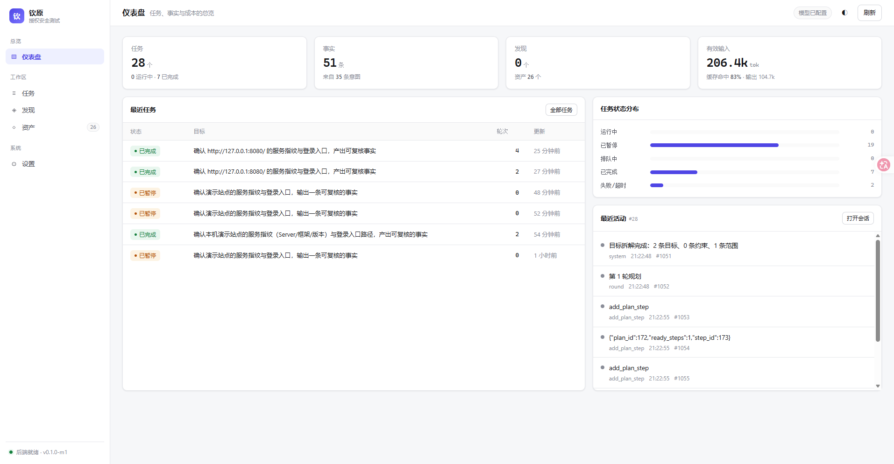

# M5 · 控制台（activity SSE + 仪表盘 + `go:embed`）

> 依据 `实现规格/06`（API/前端契约）与 ARTEX 控制台的信息架构（`.notes/web.md`）。
> 这一轮把"看不见它"解决掉：一条任务级 SSE 流 + 一个真正的仪表盘（侧边导航 / 卡片 / 表格 / 详情 Tab）。
> 本轮**不含链路图/覆盖图**（M5b）。



---

## 1. 信息架构（按 ARTEX 重做）

第一版做成了"仪器面板"（暖炭底 + 等宽活动带），评审结论是**不是仪表盘**。重做后按 ARTEX 的骨架：

```
┌────────────┬──────────────────────────────────────────────────────┐
│ 钦原        │ 仪表盘   任务、事实与成本的总览          [模型][◐][刷新] │
│            ├──────────────────────────────────────────────────────┤
│ 总览        │ ┌任务─┐ ┌事实─┐ ┌发现─┐ ┌有效输入┐                    │
│  仪表盘     │ └─────┘ └─────┘ └─────┘ └───────┘                    │
│ 工作区      │ ┌──── 最近任务（表）────┬──── 状态分布（条）───┐        │
│  任务       │ │ 状态 | 目标 | 轮次 … │ running  ████ 19    │        │
│  发现       │ └──────────────────────┴──────────────────────┘        │
│  资产       │ ┌──── 最近活动 ────────────────────────────────┐        │
│ 系统        │ └──────────────────────────────────────────────┘        │
│  设置       │                                                      │
│ ● 后端就绪  │                                                      │
└────────────┴──────────────────────────────────────────────────────┘
```

| 页面 | 路由 | 内容 |
|---|---|---|
| 仪表盘 | `#/dashboard` | 4 张 KPI、状态分布条、最近任务表、最近活动（最新任务） |
| 任务 | `#/runs` | 状态筛选 + 搜索 + 表格（状态/目标/轮次/创建/更新/操作） |
| 任务详情 | `#/runs/{id}/{tab}` | 头部（目标/徽标/元信息/操作）+ 五 Tab：概览、会话、计划、成本、覆盖 |
| 发现 | `#/findings` | 跨任务发现表（名称/等级/所属任务/目标/时间） |
| 资产 | `#/assets` | 实体表（类型/标识/状态码/标题/所属任务数/最近可见） |
| 设置 | `#/settings` | 运行形态（版本/库/模型/监听）+ 数据规模；模型凭据仍走环境变量 |

任务详情的五个 Tab（对应 ARTEX 的 overview / sessions / graph / findings）：

- **概览**：目标与达成数、计划步骤完成率、在跑/待领意图、最近事实、授权范围；
- **会话**：活动转录（历史 ∪ SSE 实时，按 `tool_use_id` 配对工具卡，可按规划/执行/系统过滤）；
- **计划**：步骤进度条 + 表（状态 / 步骤 / `expected_evidence` / 判定来源：规则 or 人工）；
- **成本**：名义/有效输入、缓存命中、每条事实成本 + 按节点与柱状条；
- **覆盖**：环形图 + 按类型明细。

---

## 2. 后端新增

| 交付 | 位置 |
|---|---|
| 进程内按 run 广播（可丢、不 close、慢客户端不拖引擎） | `internal/server/broadcast.go` |
| `GET /api/runs/{id}/activity/stream`（SSE，`id:` 帧 + `Last-Event-ID` 续传 + 15s keepalive） | `internal/server/activity_stream.go` |
| `GET /api/runs/{id}/activity/{aid}`（单条详情，懒加载 `detail`） | 同上 |
| `GET /api/stats`（首页聚合：任务/事实/发现/实体/意图/token） | `internal/store/stats.go`、`server/dashboard.go` |
| `GET /api/findings`、`GET /api/assets`（跨任务列表） | `internal/store/listing.go` |
| `store.ActivitiesAfter`（断线补齐的 DB 侧） | `internal/store/activity.go` |
| `engine.emit` 落库成功后 `Publish`（单一发射点） | `internal/engine/engine.go` |
| `/nodes` 补 `payload`（步骤正文在 payload 里，无 summary） | `internal/server/server.go` |
| `health.llm_configured` 改成真实判断（原先硬编码 `false`） | `internal/server/server.go` |

---

## 3. 前端实现（无构建链）

`internal/server/webui/{index.html,styles.css,app.js}` + `//go:embed webui`：静态文件进二进制，同端口。

- **design token**：浅色/深色两套（`[data-theme]`），`--panel/--border/--muted/--accent/--ok/--warn/--danger`；
  主题存 `localStorage`，右上角 ◐ 切换。
- **组件**：卡片、KPI、表格、徽标（状态色）、Tab、分段控件、进度条、环形图、转录行、抽屉、toast。
- **数据流**：hash 路由；5s 轮询"态势"（stats/runs/overview/tokens），会话走 SSE；
  会话容器独立滚动（`max-height: calc(100vh-300px)`），打开时贴底，用户向上翻就不裁剪。
- **文案**：状态用中文（运行中/已暂停/已完成/空闲），空态给下一步动作，错误直接显示后端中文原因。

---

## 4. 与规格的偏离（要记账）

| 规格 | 本轮 | 为什么 |
|---|---|---|
| Next.js 静态导出 + `go:embed` | 手写 SPA（三文件）+ `go:embed` | 仓库没有前端构建链；ARTEX 的 IA 可以照搬，构建形态不必照搬。架构要求（静态文件 + 单二进制 + 同端口）没变 |
| 鉴权（JWT/cookie） | 没有 | 仍只监听 127.0.0.1，开发形态 |
| 链路图 / 覆盖图 | 未做（M5b） | 需要自己写分层布局与力导向折叠，独立一轮 |
| 任务创建表单 | 未做 | 现在用 CLI/API 建任务；控制台可暂停/恢复 |

---

## 5. 验证

- `go test ./internal/server/`：广播不阻塞（1000 次 publish 2s 内返回）、`since` 回放缺口、
  实时投递、首页由二进制发出、未知 API 返回 JSON 404。
- `store.TestDashboardAggregates`：`/stats` 只统计 `kind='result'` 的 token、资产/发现列表口径正确。
- **实跑**（run #28，真实模型 + 本机靶场）：仪表盘、任务列表、详情五个 Tab、SSE 转录都正常；
  暂停 → 意图回 `open`、恢复 → 跑到 `done`。

截图：`docs/screenshots/m5-dashboard.png`、`m5-run-sessions.png`、`m5-run-overview.png`、`m5-run-cost.png`。

---

## 6. 本轮没做 / 已知缺口

1. **链路图（M5b）**：goal/intent/fact/finding 的拓扑 + 自写分层布局（DFS 断环 → 最长路径定层 → 重心法 + 位置复用）；
2. **覆盖图（M5b）**：力导向 + 按父节点折叠；
3. **鉴权**；
4. **覆盖度分母语义**：IP 目标的分母只含 `ip` 实体，而 agent 登记的是 service/endpoint，
   于是"任务成功、覆盖率仍 0%"。这是范围语义问题，需要单独决定"service/endpoint 算不算进 ip 范围"；
5. 任务列表的"意图数"列目前恒为 `—`（列表 DTO 没带意图计数），要补一个 `COUNT` 聚合。

---

## 7. 坑（这轮真踩到的）

1. **中间件把 `http.Flusher` 藏掉了**：`statusRecorder` 只包 `ResponseWriter` → SSE 的断言失败 →
   流接口 500、页面永远"重连中"。修法：实现 `Flush()` + `Unwrap()`。
2. **SSE 推的是内存对象，`created_at` 是零值**：前端显示公元 1 年（上海 LMT `08:05:43`，极像时区 bug）。
   修法：`emit` 落库成功后补 `CreatedAt`。
3. **`[hidden]` 输给 `display:flex`**：抽屉首屏就是打开的。修法：全局 `[hidden]{display:none!important}`。
4. **`<span>` 当进度条**：`bar-track/bar-fill` 是 inline，宽高不生效，条形图全是空的。
   修法：显式 `display:block`。
5. **静态资源缓存**：`max-age=300` 让"改了 CSS 刷新没变"，一度误判成规则没生效。
   修法：控制台一律 `Cache-Control: no-cache`，验证时用硬刷新。
6. **`llm_configured` 硬编码 `false`**：设置页永远显示"模型未配置"。改成按 provider 类型判断。
7. **IP 覆盖度永远 0/0**：`Coverage` 按 `sc.net` 匹配，而 IP 目标写的是 `sc.value`。
   修法：`ip` 走 `e.ip = sc.value`，`cidr` 走网段包含；补测试。
