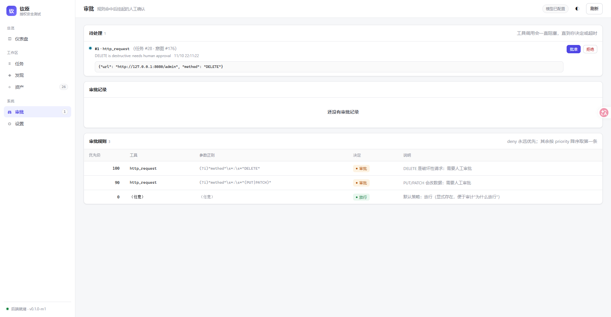

# M6a · 审批门（规则 → 人工挂起）

> 依据 `实现规格/05 §2`、`学习.md 8.1`；M6 的第一件（其次才是流量录制、复测与报告）。
> 目标：**危险动作要有人点头**，而且这件事不能靠 prompt 说教，必须卡在工具执行之前。



---

## 1. 三段式

```
工具调用 → 规则匹配（DB，priority DESC，deny 永远赢）
            ├─ allow → 执行
            ├─ deny  → 拦下（拒绝文案交回模型，意图继续）
            └─ ask   → 落 intercept_pending → 阻塞等人工 / 超时
                        ├─ allowed → 执行
                        ├─ denied  → 拦下（带拒绝原因）
                        └─ timeout → 按策略（默认 deny）
```

判官（LLM fallback）本轮**没做**：规则 + 人工已经能覆盖"破坏性操作要人点头"，
判官属于"减少人工量"的优化，等有真实规则集再上。

## 2. 数据模型

| 表 | 作用 |
|---|---|
| `intercept_rules` | run_id 为空=全局；`priority` 降序；`match_tool`/`match_regex` 为空=任意；`decision ∈ allow/deny/ask` |
| `intercept_pending` | 一次挂起：tool / tool_input / rule_id / reason / status(pending\|allowed\|denied\|timeout) / decided_by |

**默认种子（只在表为空时插入）**：

| 优先级 | 工具 | 参数正则 | 决定 | 说明 |
|---|---|---|---|---|
| 100 | http_request | `(?i)"method"\s*:\s*"DELETE"` | ask | DELETE 是破坏性请求 |
| 90 | http_request | `(?i)"method"\s*:\s*"(PUT\|PATCH)"` | ask | 会改数据 |
| 0 | （任意） | （任意） | allow | **catch-all 放行**：保证"每条放行都有规则可归因" |

catch-all allow 是刻意加的：没有它，一次放行就没有"为什么"可审计；
有了它，"谁批的、按哪条规则"永远能回答。

## 3. 规则匹配的三个硬约束

1. **deny 永远赢**：`MatchInterceptRule` 里遇到 deny 直接短路，不参与优先级比较 ——
   否则一条高优先级 allow 就能把安全底线顶掉。
2. **规则看"实际会执行什么"**：`normalizeToolInput` 把工具默认值补进匹配串
   （目前只有 `http_request.method` 默认 `GET`）。真实 run 里模型常写 `{"url": ...}`
   省略 method，规则若只看原始入参，"GET 需要审批"这类规则永远不命中 —— 这是端到端验证时抓到的。
3. **人工决定是 CAS**：`WHERE status='pending'`；重复决定 / 超时都不能覆盖已做的决定。

## 4. 阻塞与超时

- 默认等 **5 分钟**（`QINYUAN_APPROVAL_TIMEOUT_SECONDS`），每 300ms 轮询 DB；
- 超时动作默认 **deny**（`QINYUAN_APPROVAL_ON_TIMEOUT=deny|allow`）；
- 任务被暂停/取消时，挂起的审批立即标 `timeout`（原因"任务暂停/取消"），不留下悬空行；
- `QINYUAN_APPROVAL_DISABLE=1` 可整门关闭（调试用）。

被拦下时的文案（`RefusedText`）刻意写成"平台管控，不是目标的防御"：

> 【钦原平台管控·非目标防御】工具 http_request 被平台拦截。原因：… 这不是目标站点/服务的防御，
> 而是平台策略决定；换 payload、换参数、换方法都不会改变结论。

## 5. 接口与界面

| 接口 | 用途 |
|---|---|
| `GET /api/approvals?status=` | 列表（pending 按时间正序，其余倒序） |
| `GET /api/approvals/count` | 侧边栏红点 |
| `POST /api/approvals/{id}/decide` | `{decision, reason}`，冲突返回 409（已被处理/超时） |
| `GET /api/intercept/rules` | 规则只读列表（审计用） |
| `POST /api/intercept/rules` | 加规则（demo/自测；没有 UI 编辑器） |

控制台新增 **审批** 页：待处理卡（工具/原因/入参原文/批准/拒绝）+ 审批记录表 + 规则表；
侧边栏带 pending 红点。`/api/stats` 增加了 `pending_approvals`。

## 6. 端到端验证（真实模型 + 本机靶场）

1. 临时加一条规则：`http_request` + GET → **ask**；
2. 建 run #30 并 start；
3. 约 20s 后 worker 卡住，活动里出现 `等待人工审批：http_request（审批 #2）`；
4. `POST /api/approvals/2/decide {allowed}`；
5. 工具随即执行（`tool_result 200`），任务继续跑到 `done`。

这条链路证明的不是"能弹框"，而是：**工具在审批前没有执行**、批准后**没有重新规划整条意图**。

## 7. 测试

| 用例 | 守什么 |
|---|---|
| `store.TestInterceptRuleMatching` | catch-all allow / DELETE 命中 ask / 指定工具命中 / **deny 赢过高优先级 allow** |
| `store.TestApprovalDecisionIsCAS` | 重复决定失败、超时不覆盖、pending 计数正确 |
| `agent.TestGateAllowsByDefaultRule` | 默认规则放行（不打断正常探测） |
| `agent.TestGateDenyBeatsAllow` | deny 短路 + 拒绝文案是"平台管控"口吻 |
| `agent.TestGateAskThenAllow` | 挂起 → 批准 → 放行，状态与处理人正确 |
| `agent.TestGateAskTimeoutDenies` | 超时拒绝且行标 timeout |
| `agent.TestGateNormalizesDefaultHTTPMethod` | 省略 method 也能命中 GET 规则 |

## 8. 本轮没做

1. **LLM 判官**（fallback judge）：规则不命中时让模型判 allow/deny/ask；
2. **规则编辑 UI**：现在只能 API 加、DB 改；
3. **批量审批 / 预授权（P3-4）**：`升级计划` 里最危险的那一项，需要影子模式与限速，
   不在本里程碑；
4. **启动清扫**：崩溃后残留的 `pending` 行没有清理（ARTEX 也有这个缺口，记在坑里）。
