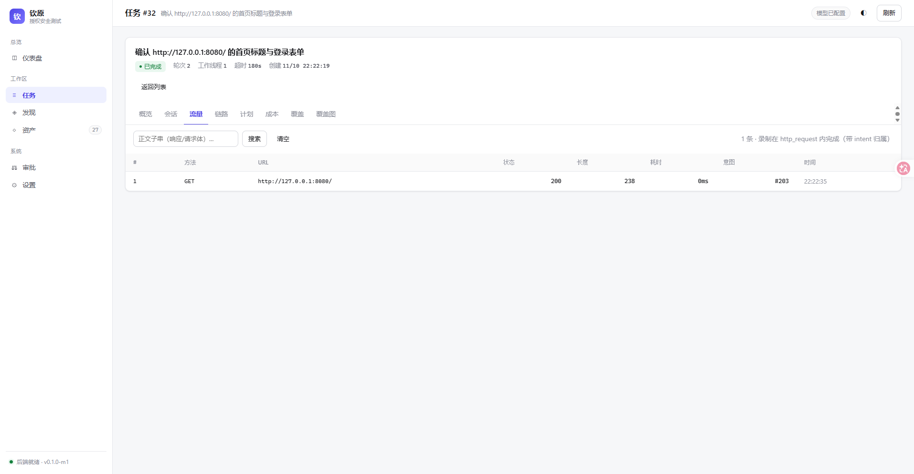

# M6b · 流量录制（工具层录制 + PG 索引）

> 依据 `实现规格/05`、`学习.md 5.2/5.4`，以及 M6 顺序（审批门 → 流量 → 复测/报告）。
> 这一轮解决"证据从哪来"：每次 `http_request` 的请求/响应都留下可检索、可回放的记录，
> 并且能绑定成 finding 的证据。



---

## 1. 关键决策：不做 MITM 代理

ARTEX 用嵌入式 go-mitmproxy（8788 端口 + 自签 CA + 注入子进程环境变量）录流量，因为它
worker 里**有 Bash**：`curl`、python、nmap 都会发出流量，只能在代理层兜住。

钦原的 worker 工具面里**没有任意命令执行**，所有目标流量都由本进程的 `http_request` 产生。所以在
工具里录：

| 维度 | 代理方案 | 工具层录制（本轮） |
|---|---|---|
| 可见范围 | 任意子进程的 HTTP(S) | 只有 `http_request`（= 当前唯一出网点） |
| 归因 | 无（进程级单一入口，ARTEX 笔记里明确是缺口） | **有** `intent_id` / `tool_use_id` |
| CA / 端口 | 自签 CA、注入 5 个环境变量、用户要装证书 | 不需要 |
| 复杂度 | ~2000 行代理 + 旁路索引 + 归档 | ~200 行录制 + PG 表 |

**回头上 MITM 的触发条件**（写死，避免"以后再说"）：

> 当工具面里出现任意命令执行（Bash / python / 外部 CLI），或要测的目标必须走非 HTTP 协议
> （SMB / Redis / 数据库）时，才引入代理。届时必须同时提供**一次性 token 的 CA 下载接口**，
> 而不是让用户去 data 目录翻 pem。

## 2. 数据模型

`traffic_exchanges`（一次交换一行）：

```
run_id, intent_id, tool_use_id, ts, method, url, url_template,
status, content_type, req_len, resp_len, duration_ms,
req_headers/resp_headers JSONB,
req_body/resp_body TEXT（≤8KB 预览，可被检索）,
req_sha/resp_sha, req_path/resp_path（>8KB 落内容寻址文件）,
is_binary, truncated, error
```

`finding_traffic`（证据绑定）：**绑定时快照**预览与 sha，`exchange_id` 允许为空 ——
流量可以被清理，证据不能因此消失。

正文策略：≤8KB 内联（可搜），更大写 `data/runs/<id>/traffic/<sha前2位>/<sha>`（内容寻址，
同内容只写一次），DB 只留 sha + 预览 + 相对路径。

## 3. 录制点与归属

`tool_http.go` 在**发完请求之后**写一条：

- 成功：方法/URL/状态/头/正文/耗时；
- **失败也录**（`status=0` + `error`）："打不通"本身是可复核的观察，
  报告里"目标当时拒绝连接"必须有据可查；
- 归属：`rc.IntentID`（意图）与 `rc.ToolUseID`（模型那次 tool_call，worker 每次调用前设置）；
- 录制失败**不影响工具返回**（只返回 `traffic_id=0`）——记账不能拖垮执行。

`http_request` 的返回值多了 `traffic_id`，模型可以直接在 `report_finding` 里引用。

## 4. 检索

`traffic_search(host, method, status, q, limit)` → 摘要列表（含正文前 400 字）。
`traffic_get(id, offset, length)` → 完整头 + 正文；落盘的正文按 `offset/length` 分页读文件。

`url_template` 归一化：**只在 path/query 上做**（UUID→`{uuid}`、长 hex→`{hash}`、数字→`{n}`），
**scheme 与 authority 原样保留** —— 否则 `http://127.0.0.1:8080/` 会变成
`http://{n}.{n}.{n}.{n}:{n}/`，按端口检索永远搜不到（本轮踩过）。

索引：`pg_trgm` 的 GIN 覆盖 `req_body/resp_body`（子串可搜、中文可用）；扩展装不上时
自动退化成 `ILIKE` 全表扫（规模小，可接受）。

## 5. 证据绑定

`report_finding(traffic_ids=[...])` → `BindFindingTraffic` 把每条交换的预览与 sha 快照进
`finding_traffic`。之后即使流量被删/被清理，`GET /api/runs/{id}/findings/{fid}/traffic`
仍能读到当时的请求行与响应片段。

## 6. 界面

任务详情新增 **流量** Tab：搜索框（正文子串）+ 表格（# / 方法 / URL / 状态 / 长度 / 耗时 / 意图 / 时间），
点行打开抽屉看完整记录（含头与正文预览）。

## 7. 验证

- `store.TestTrafficRecordSearchAndEvidence`：写入 2 条 → 按 host / 正文子串（请求体与响应体各一）
  / 方法+状态检索 → 详情带头 → 绑定证据 → **删掉流量后证据仍可读**。
- `agent.TestHTTPRecordsTraffic`：工具返回 `traffic_id`；正文子串可搜；归属到本次意图；**失败请求也留痕**。
- `agent.TestTrafficLargeBodySpillsToFile`：9000 字节响应 → 落盘文件大小正确、DB 预览 ≤8KB。
- 实跑 run #32：1 条 `GET 200 238B`，`intent #203`，控制台流量 Tab 正常显示。

## 8. 局限（有意留的）

1. **不录子进程流量**（当前没有 Bash；见 §1 的触发条件）；
2. **检索只覆盖 ≤8KB 预览**：更大的正文要 `traffic_get` 分页读文件；
3. **不解压 gzip/br**：落的就是 wire 上的字节（与 ARTEX 一致）；
4. **没有脱敏**：请求头里的 Authorization/Cookie 会原样落库 —— 上生产前必须加一个
   "敏感头打码"开关（默认开），这条记在 HANDOFF §16 待拍板；
5. 没有按 host 聚合的统计视图（M6c 报告里再做）。
