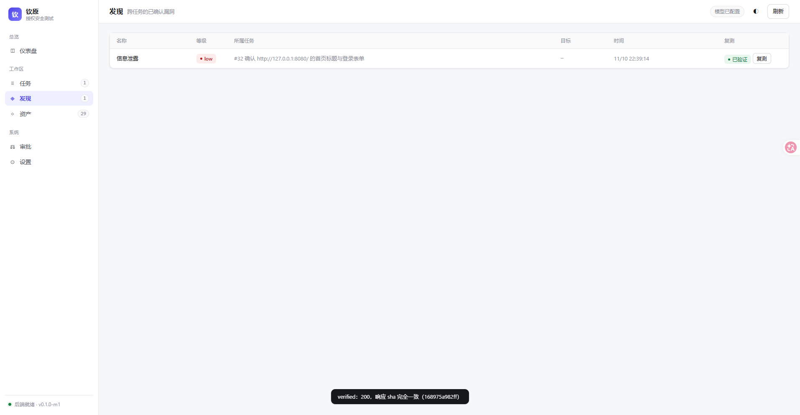

# M6c · finding 复测与报告（M6 收官）

> 依据 `升级计划` P3-2（可复现报告）与 `实现规格/07`（evidence 门槛）。
> M6 的三件（审批门 → 流量录制 → 复测/报告）到此闭环。



---

## 1. 复测：重放 + 断言，三档结论

```
finding（必须有可复现证据）
  └─ finding_traffic（绑定时的快照：method/url/status/sha/预览）
       └─ 复测：按绑定的交换重放一次 → verified / failed / unverifiable
            并把 expected / observed 一起落 finding_retests
```

**判定规则**（`agent/retest.go`）：

| 情况 | 结论 |
|---|---|
| 状态码变了 | `failed` |
| 状态码一致 + 响应 sha 完全一致 | `verified`（强） |
| 状态码一致 + 长度在 ±10% 内（sha 不同） | `verified`（弱，`observed` 里写明"sha 不同"） |
| 状态码一致但长度差异大 | `failed` |
| 流量已被清理 / 超出当前范围 / 网络失败 / 二进制 | `unverifiable`（并说明是哪种） |

三条纪律：

1. **expected/observed 必须落库**：报告里的 `verified` 要能被第三方复核，而不是一句"还在"；
2. **范围闸门照旧**：复测前用当前 `run_scope` 校验 URL —— 授权范围收窄后不允许拿旧证据去打；
3. **不复用被删的流量**：绑定行里 `exchange_id` 可为空（流量清理后），这种情况明确判 `unverifiable`。

## 2. 报告：可执行复现

`GET /api/runs/{id}/report`（`?download=1` 作为附件）生成 Markdown：

- 头部：目标 / 状态 / 创建时间 / 授权范围 / 覆盖度 / 事实与发现计数；
- **每条发现**：名称 + 等级 + 类别 + 证据 + **curl 复现命令**（由绑定流量生成）+ **复测结论**；
- 事实摘要：最近 20 条（带 confidence）；
- 结尾明确写"复测结论只对重放当时的目标状态成立"——避免把一次复测当成永久结论。

样例（run #32）：

```markdown
### 1. 信息泄露（low）

首页响应暴露版本号与框架

- **类别**：info-leak
- **证据**：GET / -> 200
- **复现**：

```bash
curl -i -X GET 'http://127.0.0.1:8080/'
```
- **复测**：verified（200，响应 sha 完全一致（168975a982ff））
```

## 3. 入口

| 入口 | 用法 |
|---|---|
| CLI | `qinyuan retest --run 32`（全部） / `--finding 213`（单条） |
| API | `POST /api/runs/{id}/findings/{fid}/retest`、`GET /api/runs/{id}/retests`、`GET /api/runs/{id}/report` |
| 控制台 | 发现页每行「复测」按钮（就地显示 已验证/已失效/无法判定）；任务详情头部「报告」按钮 |

## 4. 验证

- `agent.TestRetestVerifiedAndFailed`：httptest 目标 → 首次 `verified`（sha 一致）；
  把目标改成 500 后复测 → `failed`；复测历史两条且倒序。
- `agent.TestRetestWithoutEvidenceIsUnverifiable`：没绑定流量 → `unverifiable` 且说明"没传 traffic_ids"。
- **端到端**（run #32）：给 finding 绑定唯一那条 `GET 200 238B` 的交换 →
  `POST .../retest` 返回 `verified`，`observed` 里带 sha；报告里出现可执行的 curl 与复测结论。

## 5. 局限

1. **重放不是浏览器**：只重放一次原始请求，不执行页面里的 JS / 后续跳转链；
2. **时间相关接口会误判**：nonce/时间戳类参数会导致 `failed`，报告里已写明"只对当时状态成立"；
3. **没有批量复测的计划任务**：只能手动/CLI 触发；CI 集成（P3-3）不在本轮；
4. 报告只有 Markdown，没有 HTML/PDF；对外默认**没有脱敏**（与流量那条同源问题）。
